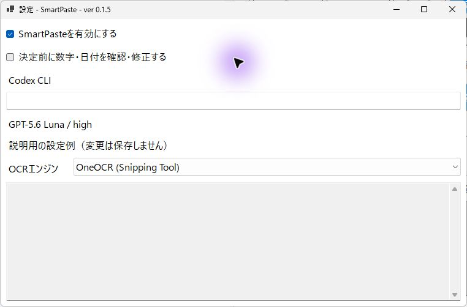
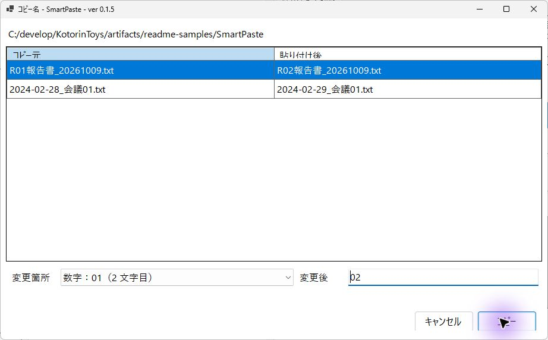
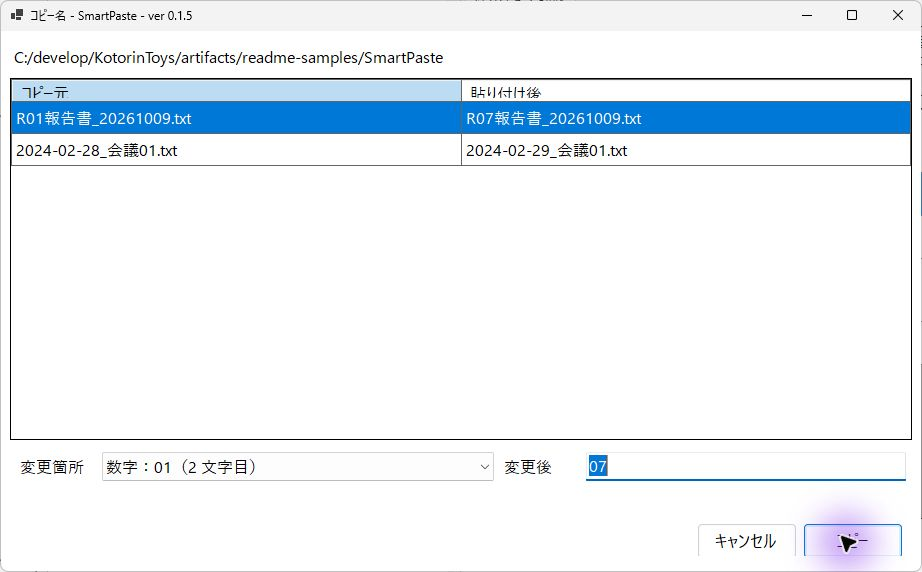
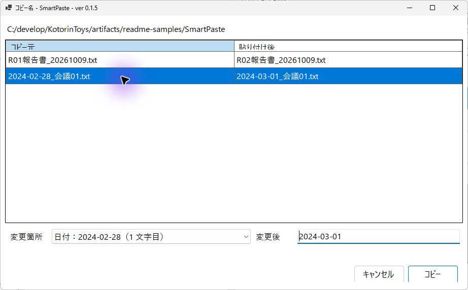
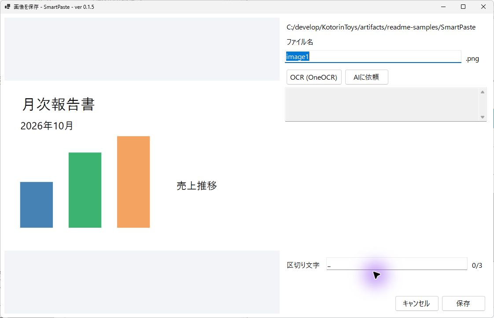
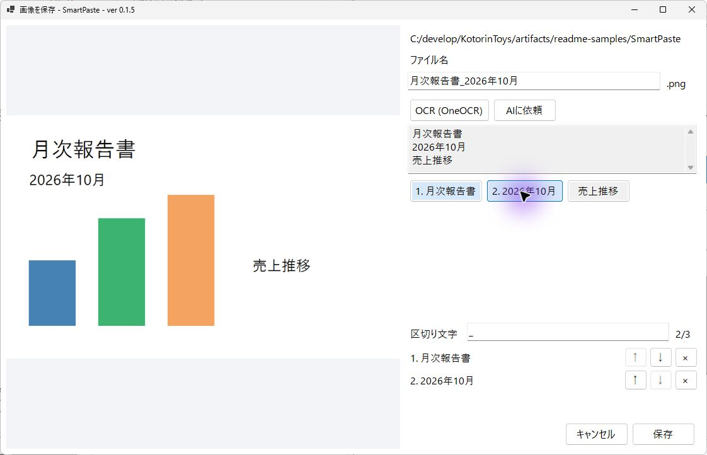

# SmartPaste

## GitHub開発版インストーラー

[Releases](https://github.com/KotorinChunChun/SmartPaste/releases)からWindows 11 x64向けのランタイム・OCRワーカー同梱インストーラーを取得できます。未署名の開発版です。このインストーラーでは.NET Desktop Runtimeの別途導入は不要です。設定は更新・削除時も保持します。下記の`release`からの起動は開発用配置の説明です。

Explorer で同じフォルダへの `Ctrl+V` と `Shift+Insert` に割り込み、数字・年月・日付を繰り上げてファイルをコピーする Windows 常駐アプリです。別フォルダへのファイル貼り付けは OS 標準の処理を使います。クリップボードの画像は、名前を入力して PNG として保存できます。

## 起動

`release\SmartPaste.exe` を起動します。.NET 8 の Windows Desktop Runtime が必要です。

起動時はウィンドウを出さず通知領域に常駐します。通知領域のアイコンから設定・一時無効化・終了を選択でき、アイコンのダブルクリックでも設定を開けます。設定画面を閉じると常駐に戻ります。従来の `--tray` 指定も利用できます。Windows の自動起動設定は変更しません。

## ファイルの貼り付け

Explorer でファイルをコピーし、貼り付け先のファイル一覧で `Ctrl+V` または `Shift+Insert` を押します。

コピー元と貼り付け先が同じフォルダの場合だけ名前を繰り上げます。複数ファイルのうちひとつでも別フォルダ由来の場合は、全体を Explorer の通常処理に渡します。

| コピー元 | 初期提案 |
| --- | --- |
| `R01報告書.txt` | `R02報告書.txt` |
| `報告009.txt` | `報告010.txt` |
| `202610_月報.txt` | `202611_月報.txt` |
| `202612_月報.txt` | `202701_月報.txt` |
| `20261009_報告書.txt` | `20261010_報告書.txt` |
| `2024-02-28_報告書.txt` | `2024-02-29_報告書.txt` |
| `2026年1月_月報.txt` | `2026年2月_月報.txt` |
| `2026年1月31日_報告書.txt` | `2026年2月1日_報告書.txt` |
| `2026.01.31_報告書.txt` | `2026.02.01_報告書.txt` |
| `2026年12月31日_報告書.txt` | `2027年1月1日_報告書.txt` |
| `yyyymmdd_報告書.txt` | `20261009_報告書.txt`（コピー日が2026年10月9日の場合） |

- 数字は +1、6桁の年月は翌月、日付は翌日へ進めます。数字の桁数、全角数字、日付の区切りを保ちます。桁あふれ時は桁数を増やします。
- 6桁数字が有効な西暦年と月の `yyyyMM` になっている場合は、年月として扱います。12月の次は翌年1月です。月が00・13以上などの場合は通常の数字として扱い、長い連番の一部分や8桁の年月日を年月として切り出すことはありません。
- 年月は `yyyy年M月`、`yyyy-MM`、`yyyy_MM`、`yyyy.MM` も判定します。日本語表記の月・日はゼロ埋めの有無を保ち、`2026年12月` は `2027年1月`、`2026年01月` は `2026年02月` とします。区切り付き数字表記は元の桁数を保ちます。
- 日付は `yyyyMMdd`、`yyyy-MM-dd`、`yyyy_MM_dd`、`yyyy.MM.dd`、`yyyy年M月d日` に対応します。実在する日付だけを日付として扱います。
- ファイル名中の文字列 `yyyymmdd` は、コピー時点の PC の今日の日付（`yyyyMMdd`）に置き換えます。大文字小文字を区別せず、`yyyymmdd.txt`、`YYYYMMDD_報告書.xlsx`、拡張子なしにも対応します。拡張子部分は対象外です。数字と混在する場合は「変更箇所」で対象を選択できます。
- 拡張子中の数字は対象外です。日付の年月日はひとつの候補として扱います。
- 数字や日付が複数ある場合は、コピー前に「変更箇所」で対象を選びます。「変更後」のテキストボックスから値も修正できます。
- 設定の「決定前に数字・日付を確認・修正する」を有効にすると、候補がひとつでも確認画面を開きます。
- 同名のファイル・フォルダがある場合は、空いている番号・日付まで自動で進めます。`yyyymmdd` から今日の日付に置き換えた場合は日付を保ち、`20261009_報告書 (コピー).txt`、`20261009_報告書 (コピー 2).txt` …を使います。手で修正した値が重複する場合は、入力の修正を求めます。
- 複数ファイルのコピーは一覧で確認します。数字のないファイルが混在する場合は元の名前を使い、重複時は `(コピー)`、`(コピー 2)` …を付けます。
- キャンセルするとコピーしません。コピー中に中止した場合、既に完了したファイルは残り、処理途中の一時ファイルは回収します。

元ファイルと既存ファイルは上書きしません。コピー時の最終更新日時を保持します。

コピー後は作成したファイルを選択し、最初のファイルに項目のフォーカスを移します。複数ファイルの場合は成功したファイルをまとめて選択します。処理中に別のアプリやフォルダへ移動した場合は選択を変更しません。

## 画像の貼り付け

画像・ビットマップをコピーして Explorer のファイル一覧に貼り付けると、画像プレビューと名前入力画面が開きます。画像の場合は常に確認画面を表示します。

- 初期名は `image1.png`。貼り付け先の `image数字.png` の最大番号に +1 した名前を提案します。
- 入力欄には拡張子を含めず、欄の右側に固定の `.png` を表示します。名前入力欄にフォーカスがあるときの Enter、または「保存」で保存します。名前が無効・重複している場合は保存せず修正を待ちます。保存後は Explorer で作成した PNG を選択し、項目のフォーカスを移します。
- 「OCR」で Windows の OCR を実行し、認識したテキストと、その行から作った名前候補ボタンを表示します。候補を押すと名前欄に反映します。
- 「AIに依頼」で Codex CLI に画像を送信し、日本語の説明と名前候補10件を表示します。名前は候補ボタンから選べます。
- OCR・AI の候補は最大3つ選べます。選択順に名前へ連結し、選択済みの候補には順番を表示します。再クリックまたは選択欄の「×」で解除できます。3つ選んでいる間は未選択の候補を無効化します。
- 「区切り文字」の初期値は `_`。任意の文字列に変更でき、空欄なら区切りなしで連結します。区切りは次回も使えるよう保存します。ファイル名に使えない区切りの場合は保存できません。
- 選択欄の「↑」「↓」で順番を入れ替えられます。選んだ候補は OCR・AI の再実行後も維持し、両方の候補を組み合わせられます。名前欄で直接修正することもできます。
- OCR は設定画面で `OneOCR (Snipping Tool)` と `Windows.Media.Ocr` を切り替えられます。初期値は OneOCR です。利用できない場合は理由を表示し、別エンジンへの自動切り替えはしません。
- OneOCR は、この PC にインストールされている Snipping Tool の DLL とモデルを自動検出します。初回と Snipping Tool 更新時に `%LOCALAPPDATA%\SmartPaste\OneOCR\バージョン名` へローカル実行用に複製します。認識は専用プロセスで行い、NPU やクラウドは使いません。Microsoft の DLL・モデルはアプリの配布物や Git に含めません。
- OneOCR は Microsoft が公開する安定 API ではないため、Snipping Tool の更新によって互換性が変わる可能性があります。`Windows.Media.Ocr` は設定で明示的に選択した場合だけ実行し、日本語の OCR 言語を優先します。
- 認識した文章・AI の説明・名前候補から半角スペースを除去し、文章の改行は維持します。
- AI は `gpt-5.6-luna`、`model_reasoning_effort="high"` に固定しています。Codex CLI のログインが必要です。実行ファイルは設定画面の「Codex CLI」で指定でき、初期値は自動検出します。
- AI の実行は画像の添付・読み取り専用・一時セッションで行います。応答待ちは3分で中止し、画面を閉じた場合も実行を中止します。
- OCR・AI の処理中はボタンの横に回転表示を出します。完了・エラー・キャンセル時に停止します。

画像ファイル自体を Explorer でコピーした場合は、画像データの保存ではなく通常のファイルコピーとして扱います。

## 画面で見る使い方

画像は0.1.5系の開発版を、説明用のファイル名・画像で動かした例です。実際の設定やコピー履歴は含みません。

### 設定を開く

通知領域のSmartPasteから「設定」を開きます。コピー前に名前を見直す場合は「決定前に数字・日付を確認・修正する」を有効にします。下図の説明用画面では変更を保存しません。

### コピー後の名前を確認する

同じフォルダーで対象ファイルをコピーして貼り付けると、数字・日付を進めた候補が表示されます。左が元の名前、右が貼り付け後の名前です。

### 連番を指定する

対象行を選び、「変更箇所」と「変更後」を指定します。下図では連番を07へ変更しています。候補を確認してから「コピー」を押します。

### 日付を変更する

日付のある行では、日付を変更する箇所を選べます。右側の候補で、変更したい部分だけが変わっていることを確認してください。

### 画像を名前付きで保存する

クリップボードの画像を貼り付けると、画像の確認とPNGの保存画面が開きます。拡張子は固定なので、ファイル名だけを入力します。

### 画像内の文字を名前に使う

「OCR」で文字を読み取り、候補を最大3つ選ぶと、選んだ順に名前へ反映されます。矢印で順番を変え、「保存」でPNGを書き出します。例では「月次報告書_2026年10月.png」を保存しました。

## 対応範囲

右クリックやツールバーの「貼り付け」、デスクトップ、仮想フォルダ・ZIP 内への貼り付けは対象外です。切り取り、フォルダを含むコピー、数字や日付のないファイルだけのコピーは Explorer の通常処理に渡します。アドレス欄・検索欄・名前変更欄や他のアプリへの貼り付けにも割り込みません。

貼り付け先の Explorer ウィンドウとアクティブなタブを特定できた場合だけ割り込みます。割り込み直後の再確認で貼り付け先やクリップボードの変化を検出した場合は処理を中止します。確認画面を開いた後は、表示されたコピー元と貼り付け先を使います。

コピーは本アプリで行うため、Explorer のコピー進捗画面や `Ctrl+Z` の取り消しには連動しません。管理者権限で動く Explorer は対象にしない運用としてください。

## 設定と履歴

設定は `%LOCALAPPDATA%\SmartPaste\settings.json` に保存します。コピー履歴とエラーは設定画面に表示し、常駐中だけ保持します。

## 開発者向け情報

ビルド・試験・説明用起動は[開発者ガイド](docs/DEVELOPERS_GUIDE.md)を参照してください。
